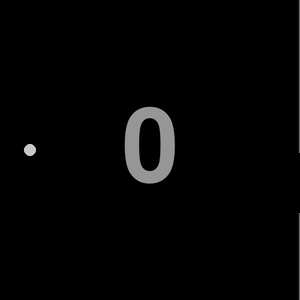
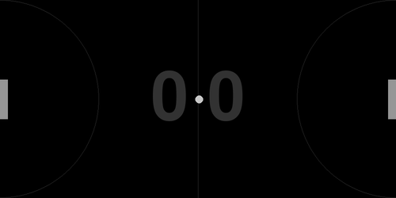
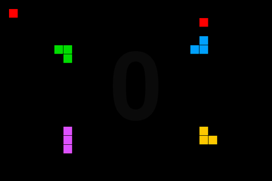
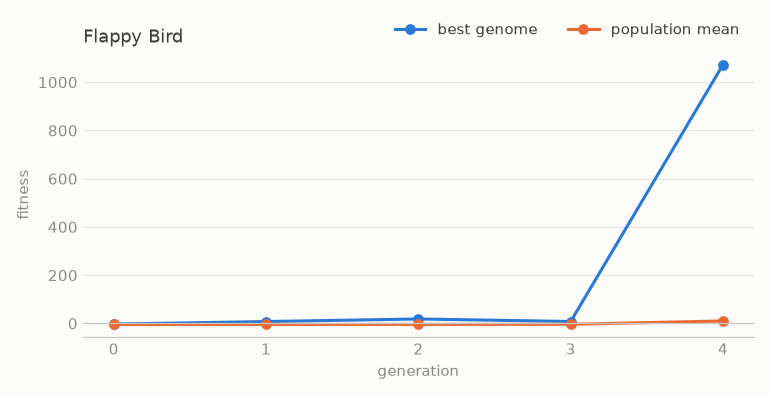
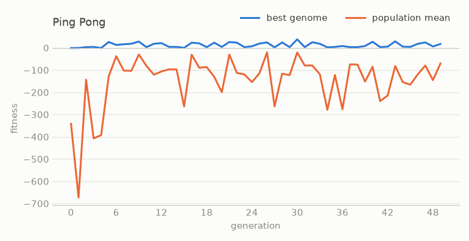
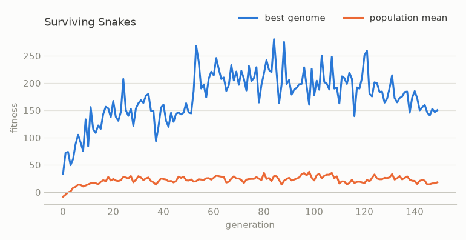

# projects_with_NEAT

Three small pygame games where neural networks learn to play. The networks are not trained with gradients: they evolve with NEAT (NeuroEvolution of Augmenting Topologies), through the `neat-python` library. Each generation, the networks play the game, the best ones are kept, mutated and crossed, and the network structure can grow over time.

| Flappy Bird | Ping Pong | Surviving Snakes |
|---|---|---|
|  |  |  |
| One bird learns to fly through the gaps. | A paddle learns to return the ball (here the same network plays both sides). | Four snakes share a board and compete for two apples. |

## Projects

### Flappy Bird ([flappy_bird/](flappy_bird/README.md))
- **Inputs (4)**: bird height, distance to the top and bottom of the next gap, vertical speed. **Output**: jump or not.
- **Fitness**: +10 per passed obstacle, +0.01 per frame. Each genome flies 3 runs per generation and keeps its worst score.
- **Result**: solved in 5 generations (100 obstacles in a row, in all 3 runs). In 10 new random runs, the saved winner reached the 500-obstacle test cap 9 times. Once it stopped at 349.



### Ping Pong ([ping_pong/](ping_pong/README.md))
- **Inputs (5)**: paddle height, ball x distance, ball y, ball speed (dx, dy). **Outputs (2)**: move up or down.
- **Training**: 1000 right paddles play at once against a left "boss" that never misses. +5 per return, -1 per frame at the screen edge.
- **Result**: training is noisy. In a 50-generation rerun (about 1 minute), the best paddle per generation scored 0 to 38, and the threshold of 41 was not reached. The included `winner.neat` is the genome from the original run. Against the boss it returns about 1.4 balls per miss. The ball speeds up on every hit, so long rallies get very hard.



### Surviving Snakes ([surviving_snakes/](surviving_snakes/PROJECT_PLAN.md))
This part was unfinished: the first attempt did not learn, even after 100,000 generations. [PROJECT_PLAN.md](surviving_snakes/PROJECT_PLAN.md) lists the bugs that were fixed and the design that works now.
- **Board**: 30 x 20 cells, 4 snakes, 2 apples. Walls, own body, other snakes (also head-on) and hunger (150 moves without food) kill.
- **Inputs (8)**, relative to the heading: is the next cell ahead / left / right blocked; where the nearest apple is; can another head step into the cell ahead / left / right. **Outputs (3)**: straight, left, right.
- **Fitness**: +10 per apple, +0.01 per move alive, -10 on death, a small bonus for moving towards food. Each genome plays against copies of itself (self-play).
- **Result**: 150 generations in about 3.5 to 10 minutes. With 4 copies of the winner on a board, a snake eats 11 apples on average (median 7, max 49). Alone, it eats 26 on average. A food-only policy gets 5 and 15.
- **Where it fails**: the snakes see only one cell ahead. Long snakes curl into their own body (46% of deaths) or into dead ends made by others (33%). They do not plan or block rivals on purpose.



## Setup

Tested with Python 3.11.

```
pip install -r requirements.txt
```

The configs use the `neat-python` 0.92 format. Version 2.x rejects them, so keep the pinned version.

## Run

Run each command from inside the project folder, because the code reads `config.txt` and the saved winner from the current folder.

| Project | Train | Watch the saved winner |
|---|---|---|
| Flappy Bird | `cd flappy_bird && python BestNeatBirdGame.py` (trains, then plays) | `python BestNeatBirdGame.py --replay` |
| Ping Pong | `cd ping_pong/complete && python main.py` (trains 50 generations, overwrites `winner.neat`, then plays) | `python NeatGame.py` |
| Surviving Snakes | `cd surviving_snakes/NeatSnake && python TrainSnake.py` | `python TrainingVisualisation.py` |

Training saves `fitness_history.csv` (best and mean fitness per generation). The tools in `tools/` make the plots and GIFs headless, from the repo root:

```
python tools/plot_fitness.py surviving_snakes/NeatSnake/fitness_history.csv docs/surviving_snakes_fitness.png "Surviving Snakes"
python tools/record_gif.py surviving_snakes/NeatSnake TrainingVisualisation:show_the_best docs/surviving_snakes.gif --every 1 --frames 900 --scale 0.75 --fps 20
python tools/record_gif.py flappy_bird BestNeatBirdGame:replay docs/flappy_bird.gif --scale 0.6
python tools/record_gif.py ping_pong/complete NeatGame:neat_best_play docs/ping_pong.gif
```

## What I learned

- **Inputs decide more than the network size.** The first snake used raw board coordinates and did not learn. Inputs relative to the heading, scaled to about [-1, 1], made the same problem learnable in minutes.
- **A crisp signal is easier to evolve than a soft one.** A "next cell is blocked: 0 or 1" input was used far more often than a "1 / distance" input that carried more information.
- **One lucky run is not a result.** A single Flappy Bird run or a single snake training run can look good by chance. Scoring each genome on several runs, and repeating each training setup several times, showed which changes really helped.
- **The training setup shapes the behavior.** Ping Pong learned better against a fixed boss than against other learners. The snakes learned to avoid each other better when their rivals were copies of themselves.
- **Every game loop needs an end.** Several bugs were loops that never stop: a perfect bird, or a snake that never has to eat again. A score cap and a hunger limit fixed them.
- **Measure what the agent does, not only the fitness.** Counting causes of death (wall, self, other snake, head-on, hunger) showed what to fix next better than the fitness curve.

## License

MIT. See [LICENSE](LICENSE).

Part of my portfolio: https://ilyaeis.github.io/?go=neat
